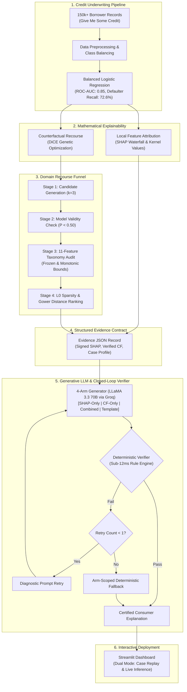

# Explainable AI (XAI) Credit Risk Decision System with LLM Recourse

[](https://www.python.org/)
[](https://scikit-learn.org/)
[](https://github.com/interpretml/diCE)
[](https://groq.com/)
[](https://streamlit.io/)
[](LICENSE)

An end-to-end, production-ready Explainable AI (XAI) pipeline for credit risk assessment that pairs machine learning predictions with mathematically faithful and domain-actionable natural language recourse.

---

## 📌 Overview

Automated machine learning models in credit underwriting evaluate default risk with high precision, but adverse credit decisions (loan rejections) require clear, verifiable justifications under regulatory mandates (such as **U.S. ECOA Regulation B / CFPB Circular 2023-03** and the **EU AI Act**). 

Traditional post-hoc explainability methods provide mathematical outputs:
- **SHAP (SHapley Additive exPlanations):** Quantifies diagnostic feature attribution (why a borrower was denied).
- **DiCE (Diverse Counterfactual Explanations):** Computes actionable feature adjustments required to reverse the decision.

However, passing raw numerical attributions and counterfactuals to unconstrained Large Language Models (LLMs) often causes **hallucinations**, **directional inversions**, or **domain-infeasible advice** (e.g., suggesting a borrower alter past late payments or reduce their income).

This project solves this challenge by implementing:
1. **An 11-Feature Actionability Taxonomy:** Strictly classifies underwriting features into immutable, historical, and modifiable attributes.
2. **An Independent 4-Stage Verification Funnel:** Enforces realistic constraints and verifies that counterfactuals truly flip the model decision before narrative generation.
3. **A Closed-Loop Deterministic Verifier:** A sub-12ms rule-based audit engine that inspects generated explanations and guarantees zero factual or directional hallucinations via automated diagnostic retry and template fallback.
4. **An Interactive Streamlit Dashboard:** Supports case-study replay and real-time live applicant scoring.

---

## 🏗️ System Architecture



---

## 🔬 Key Engineering Highlights

### 1. Eleven-Feature Actionability Taxonomy
Standard mathematical optimizers do not understand credit realities. We enforce strict domain boundaries across all 11 underwriting variables:
- **Immutable ($\mathcal{X}_{imm}$):** Features that can never change (`age`, `num_dependents`, `monthly_income_missing`).
- **Historical ($\mathcal{X}_{hist}$):** Past credit bureau delinquency history that cannot be modified retrospectively (`late_30_59_days`, `late_60_89_days`, `late_90_days`).
- **Actionable ($\mathcal{X}_{act}$):** Modifiable attributes with strict monotonic bounds:
  - `revolving_util`: Decrease only ($[0.0, 1.0]$)
  - `debt_ratio`: Decrease only
  - `monthly_income`: Increase only
  - `open_credit_lines` & `real_estate_loans`: Validated with structural constraint $\text{real\_estate\_loans} \le \text{open\_credit\_lines}$.

### 2. Independent Four-Stage Recourse Verification Funnel
Rather than relying on unverified optimizer flags, each candidate counterfactual vector passes through:
1. **Candidate Generation:** Generates diverse candidates ($k=3$) using genetic search.
2. **Model Re-Verification:** Re-evaluates candidates against the true Logistic Regression pipeline to verify $P(\text{default} \mid \mathbf{x}') < 0.50$.
3. **Taxonomy Audit:** Rejects any perturbation of immutable or historical features and verifies monotonic bounds on actionable attributes.
4. **Distance & Sparsity Ranking:** Selects the optimal recourse minimizing Gower Distance and $L_0$ feature sparsity.

### 3. Closed-Loop Deterministic Verifier
A zero-LLM Python verification engine operating in sub-12ms that audits candidate narratives across four orthogonal compliance axes:
1. **Directional Accuracy:** Ensures stated risk direction matches signed SHAP attributions.
2. **Feature Grounding:** Flags and eliminates hallucinations of attributes outside the approved schema.
3. **Numerical Consistency:** Verifies stated balances and percentages match case records within $\pm 5\%$ tolerance.
4. **Recourse Feasibility:** Confirms recommended actions match the independently verified counterfactual vector.

---

## 📊 System Evaluation & Performance

### 1. Classification Performance (Test Set: 29,946 Records)
Trained on the 150k-record *Give Me Some Credit* dataset under severe 93.4% / 6.6% class imbalance:

| Model | Class Weighting | Accuracy | Precision | Defaulter Recall | F1-Score | ROC-AUC |
| :--- | :---: | :---: | :---: | :---: | :---: | :---: |
| **Logistic Regression (Selected)** | **Balanced** | **0.8064** | **0.2144** | **0.7262** | **0.3311** | **0.8496** |
| Random Forest | Balanced | 0.9354 | 0.5430 | 0.1311 | 0.2112 | 0.8333 |

*Logistic Regression delivers superior ranking separation (0.85 ROC-AUC) while identifying 72.6% of loan defaulters.*

### 2. Recourse Funnel Attrition (N=50 Stratified Cases)
| Funnel Stage | Candidate Count | Success Rate | Cumulative Retention |
| :--- | :---: | :---: | :---: |
| Adverse Cases ($P \ge 0.50$) | 23 | — | — |
| Requested Counterfactuals ($k=3$) | 69 | 100.0% | 100.0% |
| Generated Candidates | 51 | 73.9% | 73.9% |
| Model-Valid Candidates ($P < 0.50$) | 48 | 94.1% | 69.6% |
| **Constraint-Satisfied (Taxonomy)** | **24** | **50.0%** | **34.8%** |
| **Final Fully-Verified Recourse** | **24** | **100.0%** | **34.8%** |

*Key finding: Exactly 50.0% (24/48) of mathematically valid counterfactuals generated by vanilla optimizers violated real-world feasibility.*

### 3. Verifier Ablation: Pre- vs. Post-Verification Failure Dynamics
| Experimental Arm | Pre-Verif. Violations | Post-Verif. Violations | Retry Invocations | Fallback Triggers |
| :--- | :---: | :---: | :---: | :---: |
| **Arm 1: SHAP-Only** | 18.0% (9/50) | **0.0%** | 9 | 5 |
| **Arm 2: CF-Only** | **50.0%** (25/50) | **0.0%** | 25 | 10 |
| **Arm 3: Combined** | 16.0% (8/50) | **0.0%** | 8 | **0** |
| **Arm 4: Template Baseline** | 0.0% (0/50) | **0.0%** | 0 | 0 |

*Unconstrained LLM recourse generation suffers a 50% violation rate. The closed-loop verifier eliminates violations down to 0.0% across all arms.*

### 4. Linguistic Readability Benchmark
| Experimental Arm | Flesch-Kincaid Grade Level | Flesch Reading Ease | Mean Word Count |
| :--- | :---: | :---: | :---: |
| Arm 1: SHAP-Only | 9.77 | 50.52 | 126.6 |
| Arm 2: CF-Only | 11.92 | 40.77 | 155.0 |
| **Arm 3: Combined** | **9.17** | **57.02** | **141.3** |
| Arm 4: Deterministic Template | 11.22 | 34.61 (Difficult) | 261.6 |

---

## 📁 Repository Structure

```text
├── app.py                     # Interactive Streamlit Web Application
├── requirements.txt           # Python dependencies
├── .env.example               # Environment template for Groq API key
├── .gitignore                 # Excludes secrets, caches, and temporary files
├── LICENSE                    # MIT Open Source License
├── data/
│   ├── raw/                   # cs-training.csv (Kaggle dataset)
│   └── processed/             # Cleaned datasets, stratified train/test splits
├── models/
│   ├── classification_model.joblib   # Trained Balanced Logistic Regression
│   └── regression_model.joblib       # Auxiliary imputation model
├── notebooks/
│   └── 01_eda.py              # Exploratory data analysis scripts
├── prompts/                   # Prompt contracts for experimental arms
├── reports/
│   ├── figures/               # ROC curves, confusion matrices, SHAP plots
│   ├── counterfactuals/       # Raw vs. feasible counterfactual JSON records
│   └── evaluation/            # Evidence records, funnel summaries, audit tables
├── src/
│   ├── data_prep.py           # Ingestion, cleaning, and preprocessing
│   ├── train_classification.py# Training pipeline with balanced weighting
│   ├── train_regression.py    # Auxiliary regression models
│   ├── shap_explain.py        # SHAP calculation & waterfall plot generation
│   ├── llm_client.py          # Groq Cloud API wrapper (LLaMA 3.3 70B)
│   ├── evaluation/
│   │   ├── evidence_contract.py # Structured evidence JSON compilation
│   │   └── evaluate_arms.py     # Batch experimental evaluation runner
│   └── xai/
│       ├── taxonomy.py        # 11-feature actionability definitions
│       ├── recourse_engine.py # DiCE constrained generation & 4-stage funnel
│       ├── verifier.py        # 4-axis deterministic verification engine
│       ├── generator_pipeline.py # Closed-loop generator with retry & fallback
│       └── template_baseline.py  # Deterministic zero-LLM baseline
└── tests/
    ├── conftest.py            # Pytest fixtures
    └── test_recourse_engine.py# Unit tests (40 assertions)
```

---

## 🚀 Quickstart Guide

### 1. Clone & Set Up Environment
```bash
git clone https://github.com/nandthakor/explainable-credit-risk.git
cd explainable-credit-risk

python -m venv venv
# On Windows:
.\venv\Scripts\activate
# On Linux/macOS:
source venv/bin/activate

pip install -r requirements.txt
```

### 2. Configure API Key
Create a `.env` file from the provided example:
```bash
cp .env.example .env
```
Add your free Groq API key:
```text
GROQ_API_KEY=gsk_your_groq_api_key_here
```

### 3. Run Unit Tests
```bash
python -m pytest tests/
# or standalone:
python tests/test_recourse_engine.py
```

### 4. Launch the Interactive Dashboard
```bash
streamlit run app.py
```
Open [http://localhost:8501](http://localhost:8501) in your browser:
- **Case Replay Mode:** Explore 5 precomputed credit case studies (True Positive, True Negative, False Positive, False Negative, Borderline) with SHAP waterfall plots, DiCE recourse, and multi-arm LLM explanations.
- **Live Mode:** Enter custom borrower attributes to get real-time credit default risk predictions, local SHAP attributions, verified counterfactual recourse, and verified natural language explanations.

---

## 📄 License
This project is licensed under the MIT License - see the [LICENSE](LICENSE) file for details.
